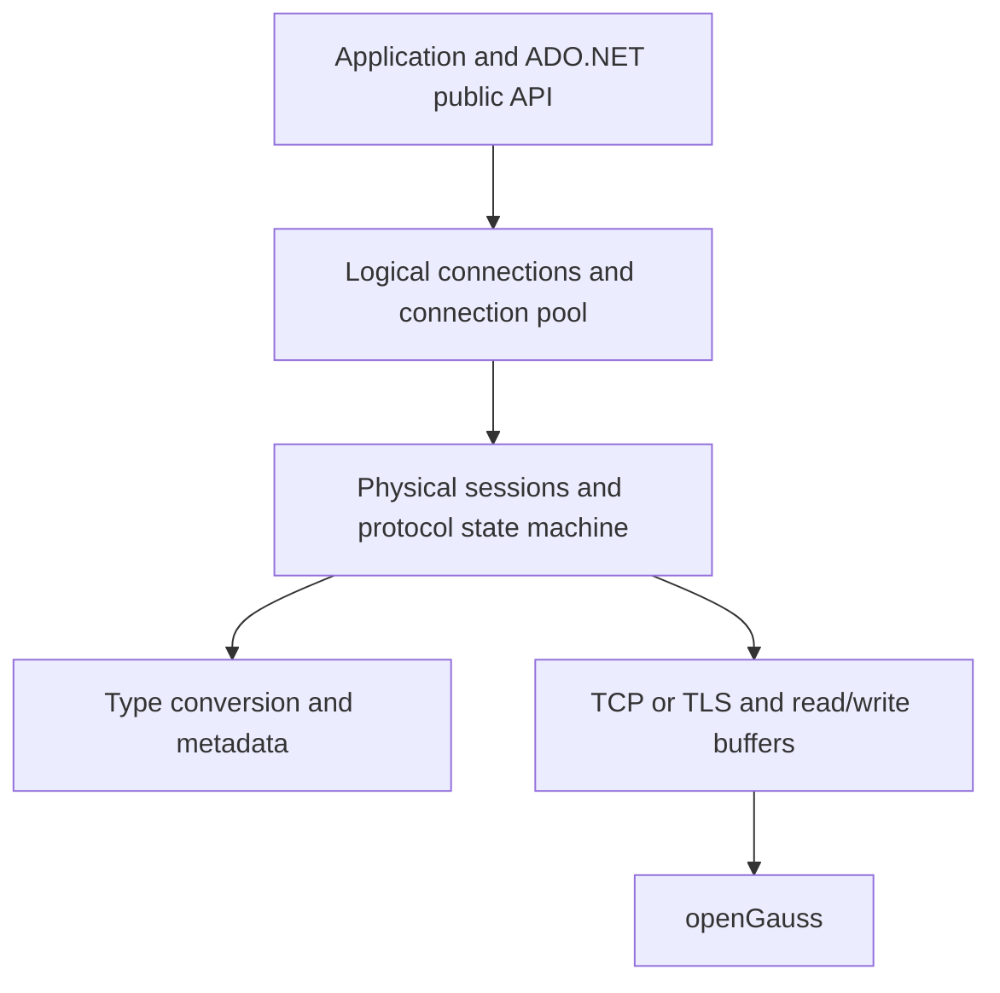

# OpenGaussConnector Driver Design

2026-11-24 · Design proposal

## Scope

Port a managed driver based on the official openGauss ADO.NET driver. The core NuGet package provides five sets of assets: `netstandard2.0`, `netstandard2.1`, `net8.0`, `net9.0` and `net10.0`. Use the openGauss JDBC release tags and server documentation as the protocol and behavior reference, and fill in capabilities according to actual needs. For versions and source baselines see [References](references.md).

The initial delivery scope covers the core driver, the dependency injection package and the five extension packages of the official ADO.NET driver. The core covers connections and authentication, TLS, parameterized execution, transactions, result reading, base types, connection pooling and core metadata. COPY, multi-host and special types are verified according to matrix priority and can be included in the supported scope after passing acceptance within the same release cycle. EF Core, oGRAC, full encryption, TLCP and the replication output plugin each keep a separate evaluation item. [Feature matrix](opengauss-connector-feature-matrix.md)

## Porting route

| Route | Impact |
| --- | --- |
| Port the official ADO.NET snapshot and upgrade item by item | Reuses connections, pipeline, type handling, generator and tests, and can track behavior changes. This is the approach for this project. |
| Fork again from modern Npgsql | Modern APIs can be reused, but openGauss startup, authentication and system catalog differences must be reintroduced, and coverage of the five TFMs handled. |
| Rewrite primarily from JDBC | The Java-side behavior model can be followed, but ADO.NET objects, asynchronous cancellation, pooling, resource lifetimes and type mapping must be reimplemented. |

The first import round keeps the upstream directory and file provenance records; mechanical renames, build adaptations and protocol behavior changes are committed separately. The generator's templates, test fixtures and licenses move with the corresponding implementation. Code or tests introduced later record the source repository, commit and file path. For the same feature, first establish behavior tests against the JDBC and server implementations, then adjust the existing .NET code. When large-scale upstream evolution occurs, evaluate porting cost per subsystem. [M1 kickoff checklist](opengauss-connector-m1.md)

## Solution and packages

| Element | Proposed choice |
| --- | --- |
| Solution | `OpenGaussConnector.slnx`, containing `src/` and `tests/` |
| Core project | `src/OpenGaussConnector/OpenGaussConnector.csproj` |
| Core assembly and root namespace | `AssemblyName` and `RootNamespace` are `OpenGaussConnector`, output is `OpenGaussConnector.dll` |
| Core NuGet package | `PackageId` is `OpenGaussConnector` |
| Dependency injection NuGet package | `src/OpenGaussConnector.DependencyInjection/OpenGaussConnector.DependencyInjection.csproj`, package ID and assembly name are `OpenGaussConnector.DependencyInjection`, released with the same version as the core library, providing five sets of target assets |
| Provider invariant name | Planned to use `OpenGaussConnector`, with `OpenGaussFactory.Instance` as the registration entry point |
| Existing public types | Keep type names such as `OpenGaussConnection`, `OpenGaussCommand`, `OpenGaussDataReader`, `OpenGaussTransaction`, `OpenGaussParameter`, `OpenGaussConnectionStringBuilder`. Their namespaces, assembly identity and factory registration move with the project. |
| Port packages for the five official extensions | GeoJSON, Json.NET, NetTopologySuite, NodaTime, OpenTelemetry. Projects, assemblies and package IDs are in the table below. |
| Generator and tests | The generator is planned to keep `netstandard2.0` as an internal build project. Tests and benchmarks are explicitly marked as not packable. |

Explicitly declare `PackageId` in packable projects. The six extension packages and the core package use the same project version, and following OB, the corresponding release version serves as the lower bound of the core dependency. When packing, check the dependency IDs and version ranges in the actual `.nuspec`. NuGet.org query results for each package are in [References](references.md).

When porting from the official `OpenGauss.NET`, applications need to be recompiled and their `using` directives, assembly-qualified type names, factory registration and third-party plugin references updated. In-process coexistence is verified by consumer tests. The upstream connection string keys, SQLSTATE and core public type semantics serve as the porting baseline. Any change involving time, authentication or certificate default behavior is listed item by item in the release notes. The existing binding identity and strong-name signature are folded into the M1 evaluation; signing uses the project's own identity.

## Target frameworks and central package management

The root `Directory.Build.props` centrally sets package versions, nullability and deterministic builds. The root `Directory.Packages.props` enables `ManagePackageVersionsCentrally`, defines `PackageVersion` per `$(TargetFramework)`, and project files declare versionless `PackageReference` only on the TFMs that need the dependency. Every packaged dependency is declared as a NuGet range rather than a fixed version, and the ranges are confirmed in M1 by restore results and consumer tests. No `global.json` pins the SDK version; the .NET 10 SDK installed on the development machine is used directly, and the actual version is recorded in the acceptance record. [Microsoft CPM](https://learn.microsoft.com/en-us/nuget/consume-packages/central-package-management) · [SLNX](https://learn.microsoft.com/en-us/dotnet/core/tools/dotnet-sln)

| TFM | Dependency and API strategy | Consumption verification |
| --- | --- | --- |
| `netstandard2.0` | Evaluate legacy package references such as `Microsoft.Bcl.HashCode [6.0.0,)`, `System.Text.Json [10.0.0,)`, `System.Threading.Channels [10.0.0,)`, `System.Collections.Immutable [10.0.0,)`, `System.Diagnostics.DiagnosticSource [10.0.0,)` and `System.Runtime.CompilerServices.Unsafe [6.1.2,)` item by item, and keep the floor restorable from the code and the chosen host. | Tests that force-load this asset, then an isolated consumer project to inspect `project.assets.json`. Any .NET Framework support claim must be measured on the chosen version on Windows; 4.8 is the first candidate. |
| `netstandard2.1` | Inspect the reference assembly and TFM assets separately, keeping necessary supplementary BCL dependencies. | Force-load this asset in a modern host and run core cases; record the actual host and the selected DLL in the report. |
| `net8.0` | Prefer the shared framework. When a direct package dependency that ships with the framework is needed, centrally declare the floor `[8.0.0,)`. | .NET 8 process restore, build and run. |
| `net9.0` | Prefer the shared framework. When a direct package dependency that ships with the framework is needed, centrally declare the floor `[9.0.0,)`. | .NET 9 process restore, build and run, and record the runtime maintenance status. |
| `net10.0` | Prefer the shared framework. When a direct package dependency that ships with the framework is needed, centrally declare the floor `[10.0.0,)`. | .NET 10 process restore, build and run. |

The version-line convention applies to the framework-shipping dependencies chosen by this project, such as `Microsoft.Extensions.DependencyInjection.Abstractions`, `Microsoft.Extensions.Logging.Abstractions` and `System.Diagnostics.DiagnosticSource` when referenced as needed. Each project adds references according to actual use. Third-party libraries and test tooling choose versions independently; compiler generator dependencies are for build only. What is centrally declared is the NuGet range: framework packages use an open floor and third-party plugins a floor capped at the next major version, so the acceptance record captures the exact resolved version and tests consumers using a higher compatible patch version. When transitive pinning is needed, first verify its impact on the released dependency set. [References](references.md) · [.NET Standard](https://learn.microsoft.com/en-us/dotnet/standard/net-standard)

Audit the `NET5_0`, `NET6_0`, `NETCOREAPP3_1` and Standard branches in the legacy source, replacing branches that only match legacy TFMs with the corresponding capability conditions. The existing `OpenGaussBatch` and `CreateBatch` port along with the core. Modern targets use the platform `DbBatch`; the Standard upstream baseline provides a same-named type through `Shims/Batching.cs`. Verify the batch entry point of each asset set separately, and the assembly binding of a Standard-compiled caller on a modern host. Measured consequence of the shim: virtual batch members resolve through the shim type, so a caller compiled against the Standard asset that touches a batch cannot run on .NET 6 or later (`TypeLoadException`). Non-batch APIs bind normally. A library that needs batches must multi-target or keep the batch calls in the application assembly. Modern targets add a `DbDataSource` implementation for DI and direct use. New APIs mark the target frameworks where they are available in the signature baseline. Microsoft's support policy page lists 2026-11-10 as the end of support for .NET 8 and .NET 9. These two TFM sets are still packed and verified as required by the project, and the release documentation records host maintenance status. [.NET support policy](https://dotnet.microsoft.com/en-us/platform/support/policy/dotnet-core)

## Dependency injection

Refer to OB's `OceanBaseServiceCollectionExtensions.cs`. Provide extension methods in the `Microsoft.Extensions.DependencyInjection` namespace. Applications can install the DI package as needed; the core package can be used standalone.

| API | Available assets | Lifetime and ownership |
| --- | --- | --- |
| `AddOpenGaussConnection(connectionString)` | Five TFMs | Registers a transient `OpenGaussConnection`. Each resolve yields an unopened connection, and the scope that resolved it is responsible for disposal. An existing `DbConnection` registration takes precedence; an alias is added when it is absent. |
| `AddOpenGaussDataSource(connectionString, configure)` | .NET 8/9/10 | Registers a singleton `OpenGaussDataSource`, disposed by the container. An existing `DbDataSource` registration takes precedence; an alias is added when it is absent. `configure` is `(IServiceProvider, OpenGaussDataSourceBuilder)`. |
| `AddOpenGaussLogging()` | Five TFMs | Registers the `ILoggerFactory` bridge; resolving a connection or data source installs it as the process-wide driver logging provider. |
| `AddKeyedOpenGaussDataSource(serviceKey, connectionString, configure)` | .NET 8/9/10 | Each service key owns an independent data source and connection pool. The concrete type and `DbDataSource` resolve to the same instance for the same key. `configure` is as above. |

The core library for modern TFMs provides `OpenGaussDataSource` and `OpenGaussDataSourceBuilder`. A data source holds its own `ConnectorSource`, so multiple data sources built from the same connection string do not share a pool and are not affected by process-level pool management; connections created from a data source cannot change their connection string, disposing a connection returns it to that data source's pool, and disposing the data source disposes the pool. The DI package routes the driver's log entries into the container's `ILoggerFactory`: `AddOpenGaussLogging()` registers an `IOpenGaussLoggingProvider` bridge, and resolving a connection or a data source installs it through `OpenGaussLogManager.TrySetProvider`. The driver's logging entry point stays process-wide, so the first installed provider wins for the process and an application that assigns `OpenGaussLogManager.Provider` itself is never overridden; a per-data-source `ILoggerFactory` would require making logging instance-scoped and remains a later change. Verify registration conflicts, duplicate service keys, automatic disposal, use after disposal, singletons across scopes and logging factory ownership. The same data source can be resolved through the concrete type and the base type alias, and disposal must be idempotent. `CreateCommand` and `CreateBatch` on the data source itself are not supported and throw `NotSupportedException` with a pointer to `CreateConnection`: the ported command obtains its physical connector from a connection, so data-source-owned commands need data-source-aware command support in the command and are tracked as a post-M1 enhancement. An unowned command that can never execute is worse than an explicit refusal.

| Assets | `Microsoft.Extensions.DependencyInjection.Abstractions` | `Microsoft.Extensions.Logging.Abstractions` | `Microsoft.Extensions.DependencyInjection` |
| --- | --- | --- | --- |
| `netstandard2.0`, `netstandard2.1` | `[8.0.0,)` | `[8.0.0,)` | `[8.0.0,)` |
| `net8.0` | `[8.0.0,)` | `[8.0.0,)` | `[8.0.0,)` |
| `net9.0` | `[9.0.0,)` | `[9.0.0,)` | `[9.0.0,)` |
| `net10.0` | `[10.0.0,)` | `[10.0.0,)` | `[10.0.0,)` |

These versions are defined per TFM by the root CPM. Every dependency of a published package is declared as a NuGet range, so a consumer can take a newer patch or minor release without waiting for a new release of this provider: framework and `Microsoft.Extensions.*` packages use an open floor (`[8.0.0,)`), and third-party plugins use a floor capped at the next major version (`[1.4.1,2.0.0)`). The two Standard sets provisionally take `[8.0.0,)`, prioritizing compatibility with existing 8.x consumers. The DI package references DI Abstractions directly; Logging Abstractions is referenced when logging integration is implemented. The full DI container package is used for tests and samples, and core package dependencies are declared only when the corresponding APIs are used. Packing is followed by `eng/Verify-Packages.ps1`, which checks the dependency ranges in the seven `.nuspec` files and then restores, builds and runs throwaway consumers from a local package source. [OB and NuGet metadata](references.md)

## Official ADO.NET extension packages

The upstream targets and dependency versions come from the project files of the pinned snapshot and serve as the porting starting point. The new package IDs in the table below also serve as project and assembly names. The five extensions use the same five target frameworks as the core and DI. Third-party libraries choose their CPM versions according to their own assets and APIs, and the exact resolved results are recorded after verification. Upstream extension methods are all exposed from `OpenGauss.NET`; after the port the method names are kept and applications import these methods from `OpenGaussConnector` instead. [Upstream project inventory](references.md)

| Upstream project | New package ID | Target frameworks and direct dependencies (after port) | Retained registration entry point and capabilities |
| --- | --- | --- | --- |
| `OpenGauss.GeoJSON.NET` | `OpenGaussConnector.GeoJSON` | Five TFMs, `GeoJSON.Net [1.4.1,2.0.0)` (upstream 1.2.19 depends on the vulnerable `Newtonsoft.Json 10.0.2`) | `UseGeoJson`, converting EWKB values of PostGIS `geometry` and `geography` to and from GeoJSON objects, retaining default type, bounding box and legacy CRS options |
| `OpenGauss.Json.NET` | `OpenGaussConnector.Json.NET` | Five TFMs, `Newtonsoft.Json [13.0.4,14.0.0)` | `UseJsonNet`, supporting `json`, `jsonb`, CLR type registration and `JsonSerializerSettings` |
| `OpenGauss.NetTopologySuite` | `OpenGaussConnector.NetTopologySuite` | Five TFMs, `NetTopologySuite.IO.PostGIS [2.1.0,3.0.0)` | `UseNetTopologySuite`, mapping `geometry` and `geography` to NTS types, retaining precision model, coordinate sequence, dimension and default type configuration |
| `OpenGauss.NodaTime.NET` | `OpenGaussConnector.NodaTime` | Five TFMs, `NodaTime [3.3.7,4.0.0)` | `UseNodaTime`, porting date, time, timestamp, interval and the range types that have server-side evidence |
| `OpenGauss.OpenTelemetry.NET` | `OpenGaussConnector.OpenTelemetry` | Five TFMs, `OpenTelemetry [1.20.1,2.0.0)` (the `OpenTelemetry.API 1.1.0` referenced upstream neither contains `TracerProviderBuilder` nor is free of CVE-2026-40894; 1.21.0 is the newest release, but it pulls `Microsoft.Extensions.*` 11.0.0, so 1.20.1 is the newest usable release) | `AddOpenGauss`, subscribing to the core `ActivitySource` and verifying command tracing |

- **Mapping isolation**. Keep the upstream type mapping extension methods, and have the modern DataSource Builder provide the same mapping entry point for DI callback configuration. Isolate mapping settings per data source or connection, verifying the resolution precedence of GeoJSON/NTS and built-in JSON/Json.NET separately. The two GIS packages check server extensions, type OIDs, SRIDs, coordinate dimensions and actual EWKB. The 6.0.0 PostGIS documentation lists `geometry` and `geography`, and the 7.0.0 extension notes list PostGIS 2.4.2. Record the actually installed version when against a live server, and verify behavior when the extension is absent. Keep the `ShortCRS` and `LongCRS` compatibility options, document that the driver mapping preserves source coordinates, and verify that GeoJSON labeled RFC 7946 externally uses WGS 84 longitude/latitude. [OG11, EXT1, EXT2](references.md)
- **Json.NET and NodaTime**. Json.NET verifies POCOs, JSON tokens, NULL, text and binary, and custom settings. By default avoid enabling polymorphic type resolution from data; when a customer explicitly enables that mode, handle type restrictions per the Json.NET guidance. NodaTime verifies current and legacy time semantics, time zones and infinite values; intervals containing months or years use the `Period` path, and fixed durations use `Duration`. Range and multirange reads depend on each environment's type capabilities. [EXT3, EXT4](references.md)
- **OpenTelemetry**. The legacy `AddOpenGauss` subscribes to `OpenGauss`, and its `options` parameter is not applied. During the port, unify the source names on the core emitting side and the extension subscribing side, and check whether in-process coexistence with the legacy package causes duplicate collection. Design tags and exception events per the database span specification. By default do not collect raw connection strings, user names, unsanitized SQL, parameter values or error details that may contain sensitive content. Acceptance includes listening, the configuration items in effect, success and exception paths, and redacted output. [EXT5, EXT6](references.md)
- **Migrating upstream tests**. Bring the plugin, NodaTime, ADO.NET specification and trimming tests into the SLNX, and fix legacy project references and target frameworks. The legacy GeoJSON and NTS tests are guarded by conditional compilation; CI enables them explicitly and records the actual executed count. Add the listening scenarios for OpenTelemetry. Benchmarks keep an independent entry point along with the port. [Upstream project inventory](references.md)

## Driver layering

### Startup, authentication and connections

- Establish the baseline with 3.51, which the ADO source uses fixed, and compare the startup messages and authentication branches of 3.0, 3.50 and 3.51 against the JDBC tags. Selection of a compatibility protocol must be backed by specific server-side cases. Authentication failures and certificate validation failures return directly, so that applications do not misread them as network problems and retry.
- Request code 10 in ADO actually takes the openGauss SHA256 path. Its source also contains PostgreSQL SCRAM methods. JDBC uses request codes 11 and 13 for MD5-SHA256 and SM3 respectively, while ADO's legacy enum uses 11 for SASL continue. The implementation should interpret request codes in the context of startup protocol information and authentication state. Pin behavior with tag sources, reproducible server configurations, and success and failure cases.
- TLS keeps the `SslStream` entry point; the porting baseline retains the `Prefer` default and the legacy `Require` requirement for an explicit `Trust Server Certificate`. Server identity verification cases use `VerifyCA` or `VerifyFull`, where `VerifyFull` also covers the host name. Verify client certificates, certificate rejection, cancellation and timeout paths. Authentication challenges, keys, credentials and command parameters are filtered from diagnostic output by default.
- While establishing a new physical connection, the next candidate host can be chosen according to policy. Statements and transactions already executing report failure to the caller on connection loss; writes or commits with unknown results are left to the business to judge. The connection pool only returns connections whose state has been explicitly restored, and destroys physical connections that are protocol-out-of-sync, whose cancellation failed or whose reset failed.
- Pools are isolated by connection configuration; verify role changes, pool keys, session state reset, the prepared statement cache and existing transaction state. JDBC's automatic topology, statement routing and ATF are each researched, recording the required versions and components. [Feature matrix](opengauss-connector-feature-matrix.md)

### Server versions and capability selection

The same NuGet package covers multiple verifiable openGauss server versions. The driver determines the version and capabilities inside the physical connection, and the connection, command, reader, COPY and metadata APIs keep using the same entry point.

1. **At startup**, follow the verified ordinary openGauss startup protocol and select the corresponding handling based on the actual authentication messages. The server product version usually cannot be confirmed until after authentication. If a protocol needs a different startup message, handle it through separate protocol configuration and validation in the corresponding environment.
2. **At connection initialization**, retain the raw value of the startup parameter `server_version` and the existing `DbConnection.ServerVersion` semantics. Use the recognizable product marker and version number in `SELECT version()` to identify the openGauss product version, retaining the raw result. For servers that support the parameter, execute `SHOW sql_compatibility` to obtain the database compatibility mode. When identification is affected by permissions, version format or a proxy, record the unknown state separately. [OG6, OG13](references.md)
3. **Configure the expected version**. The connection string setting `Server Version` defaults to `Auto`. It can also be set to verified target versions such as `6.0.6`, `7.0.0`. The explicit configuration is compared with the identifiable product version; on conflict, connection initialization reports an error and closes that physical connection. When the version is unknown, the explicit version may select a verified candidate compatibility path, and diagnostics retain the actual result of an unknown version. Features constrained by version, extensions or topology must still satisfy the actual conditions of use. Implemented: `OpenGaussConnectionStringBuilder.ServerVersion`, the probe in `src/OpenGaussConnector/Internal/OpenGaussServerVersion.cs`, the per-physical-connection check after the database-info load (so a cached `OpenGaussDatabaseInfo` cannot skip it), and the `OpenGaussConnection.OpenGaussVersion`, `LongServerVersion` and `CompatibilityMode` diagnostics. `SHOW sql_compatibility` is only probed when `SELECT version()` identifies openGauss, and a refused probe leaves the mode unknown instead of failing the connection.
4. **Capability selection**. Use the verified version range to decide candidate implementations, then confirm based on product form, mode, system catalog, extensions and topology. The legacy driver judges range, multirange and various `DISCARD` operations by PostgreSQL version thresholds; during the port, change each to openGauss measurement or capability probing. Optional probes use fixed, read-only queries with timeouts. Object absence, insufficient permission and network or protocol failures are handled separately. Unknown versions default to the verified baseline path, and optional capabilities are enabled after confirmation. When a capability is not enabled, return the corresponding explicit error or use a verified compatibility path.
5. **Caching and upgrades**. Each new physical connection rebuilds capability information for its actual target. When catalog metadata is reused, isolate it by physical endpoint, database, version, mode and the permissions and extensions that affect results. Re-identify after reconnect, primary/standby switchover or pool clearing. Release acceptance covers replacing an old version with a new one, mixed versions in the same host list, explicit version conflicts and unknown versions. The execution results of existing writes and transactions are reported by the current connection and its error state.

| Scenario | Driver-internal handling |
| --- | --- |
| Catalog fields differ across versions or modes | Confirm the fields first, then choose the metadata SQL. Generated column expressions, flags and data types are filled from the obtainable results. |
| A version provides a new extension or type | Locate the extension, type name and OID from the current database catalog. Verify text and binary formats on a real server for the read and write paths separately. |
| The server backports a capability or an upgrade keeps an original GUC | Handle it using the probed capabilities and session state. For an example, see the D database default parameter change in the 7.0.0 enterprise edition release notes. |
| COPY or streaming parameters need buffer limits | All versions share client-side resource limits and explicit error semantics. COPY formats available on the server are still verified separately per target combination. |
| oGRAC, ATF, multi-vector concurrent queries | Check the product protocol, server components and extensions separately; the base driver maintains the verified ordinary openGauss connection path through the same package. |

Public release versions and JDBC tags are in [References](references.md). The server versions deployed by users and their upgrade situation are still to be investigated; 6.0.6 and 7.0.0 are the acceptance environments planned to be established. [Version difference matrix](opengauss-connector-feature-matrix.md#jdbc-release-version-differences)

### Execution, types and metadata

- Reuse the Parse/Bind/Execute/Sync path, the SQL parameter parser and the read/write buffers. Verify named parameters, `$1` parameters, preparation, multiple results, batch error boundaries and affected row counts. Pin the reusability of a connection after failure with error, timeout and cancellation tests inside and outside transactions.
- Batch execution, batch SQL rewriting and COPY each have their own execution semantics. First restore the existing batch APIs. Rewrite optimizations must verify the statement applicability, generated keys, failure position and explicit transaction behavior.
- Base types first cover strings, binary, integers, floating point, boolean, `numeric`, date/time, UUID and JSON. Determine text and binary capabilities from the server OID, type name and metadata. Type information returned by a connection is recorded and isolated together with the database, version, compatibility mode and extension conditions, preventing a pool from cross-using the wrong type mapping.
- Verify A, B and PG `numeric` precision, time zones, timestamps, empty strings, identifiers, and function and procedure semantics item by item. Keep the same public parameter and read model, adjusting catalog queries, OID handling and SQL generation as needed. Upstream `CommandType.StoredProcedure` generates `SELECT * FROM` function calls, which serves as the upgrade compatibility baseline. Verify procedures and output parameters per mode through explicit `CALL`, and record changes in public API semantics separately.
- `GetSchema` and result column metadata first cover user-visible tables, columns, primary keys, indexes and constraints. Verify identity, default values, generated columns, same-named tables and permission filtering separately. Server version, compatibility mode and client declarations are reconciled against evidence collected after connecting.

## Server and build acceptance

| Environment | Verification scope |
| --- | --- |
| openGauss 6.0.6 LTS | First feature baseline. Plan to cover A, B and PG, establishing core verification on a single node first, then adding primary/standby. |
| openGauss 7.0.0 LTS | The same core cases, plus a review of release note changes affecting SQL, type or catalog behavior. Record specific forms such as enterprise edition and lightweight edition. |
| Legacy versions and other compatibility modes | Candidate coverage is determined by real deployment needs and available environments; record 5.x, other compatibility modes, extensions and product release forms separately. |
| oGRAC 7.0.0 LTS | A separate environment and case group; check multiple instances, connection roles, session state and failure behavior. |

Compatibility mode follows the database creation configuration and session queries. The legacy ADO test material contains A, B and PG examples, which form the first batch of test scope. The 6.0.0 database creation documentation also lists mode C, and the 7.0.0 enterprise edition release notes involve D database behavior. C and D are added separately according to actual deployment conditions. The legacy connection string item `Server Compatibility Mode` has `None`, `Redshift` and `NoTypeLoading`; handle it per upstream connection behavior during the port. For every combination claimed as supported, record the server build number, database mode, authentication method, TLS configuration, host and asset TFM. [OG2, OG6, OG13](references.md)

Run the relevant offline cases before committing; release candidates run build and consumer tests for .NET 8/9/10 on Windows and Linux. Plan to run the complete core online set with `net10.0` on the available A, B and PG combinations of each server version, and run connection, parameterized query and transaction smoke tests separately with the five package asset sets on one verified mode of each version. The core online set covers parameterized CRUD, commit/rollback/savepoint, column metadata, pool reuse, recovery after cancellation and connection handling after failure. TLS, primary/standby, COPY, plugins and replication record their coverage conditions independently. When a discrepancy appears, compare on the same server using a pinned version of the official driver or server SQL, and record the specific failure and environment conditions.

## License and release

The core port retains the openGauss Mulan PSL v2 and Npgsql upstream notices in the official ADO.NET driver. Check the distribution terms of copied content and dependencies file by file. If JDBC code or tests are referenced, review the top-level license, file headers and third-party notices. The repository and NuGet packages retain the required license texts, provenance records and notices; before release confirm the NuGet license metadata, trademark assets and signing identity. [References](references.md)

Plan to use a separate 0.x prerelease series, with versions decoupled from server versions. Release candidates are produced by `dotnet pack`; check item by item the `.nuspec` package IDs of the seven packages, the lower bound of the extension-to-core dependency, the five `lib/<TFM>/` asset sets and each set's direct package dependencies. Also check test and generator isolation, README, license, symbols and Source Link. Use Package Validation to check APIs across compatible TFMs, then consume package by package from a local package source, verifying asset selection, public registration APIs and inter-package dependencies; `eng/Verify-Packages.ps1` performs this inspection and consumption run from the produced folder, including a `netstandard2.0` and a `netstandard2.1` consumer and `net8.0`/`net9.0`/`net10.0` console programs. Record online acceptance results by server version, mode, extension, topology and TFM. [MS8](references.md) · [Development progress](opengauss-connector-progress.md)
