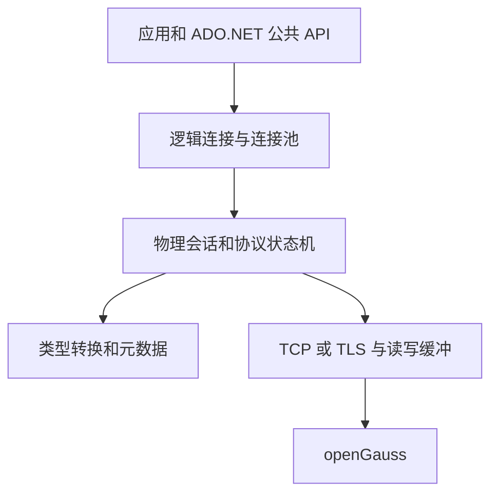

# OpenGaussConnector 驱动设计

2026-11-24 · 设计提案

## 范围

基于 openGauss 官方 ADO.NET 驱动移植托管驱动。核心 NuGet 包提供 `netstandard2.0`、`netstandard2.1`、`net8.0`、`net9.0`、`net10.0` 五组资产。以 openGauss JDBC 发布标签和服务端文档为协议与行为参考，按实际需求补齐能力。版本和源码基线见 [参考资料](references.md)。

首发交付范围包括核心驱动、依赖注入包和官方 ADO.NET 的五个扩展包。核心覆盖连接与认证、TLS、参数化执行、事务、结果读取、基础类型、连接池和核心元数据。COPY、多主机和特殊类型按矩阵优先级验证，可在同一发布周期通过验收后纳入支持范围。EF Core、oGRAC、全密态、TLCP 和复制输出插件各自保留独立评估项。 [功能矩阵](opengauss-connector-feature-matrix.md)

## 移植路线

| 路线 | 影响 |
| --- | --- |
| 移植官方 ADO.NET 快照，逐项升级 | 复用连接、管线、类型处理、生成器和测试，能追踪行为变化。作为本项目的方案。 |
| 从现代 Npgsql 重新分叉 | 可复用现代 API，需重新引入 openGauss 启动、认证与系统目录差异，并处理五个 TFM 的覆盖。 |
| 以 JDBC 为主重写 | 能沿用 Java 侧行为模型，ADO.NET 对象、异步取消、池化、资源生命周期和类型映射需要重新实现。 |

第一轮导入保留上游目录与文件来源记录，机械重命名、构建适配和协议行为改动各自提交。生成器的模板、测试夹具和许可证随对应实现迁移。后续引入的代码或测试记录来源仓库、提交和文件路径。同一功能优先以 JDBC 与服务端实现建立行为测试，再调整已有 .NET 代码。遇到大范围上游演进时，按子系统评估移植成本。 [M1 开工清单](opengauss-connector-m1.md)

## 解决方案与包

| 元素 | 拟采用 |
| --- | --- |
| 解决方案 | `OpenGaussConnector.slnx`，含 `src/` 与 `tests/` |
| 核心项目 | `src/OpenGaussConnector/OpenGaussConnector.csproj` |
| 核心程序集与根命名空间 | `AssemblyName` 和 `RootNamespace` 为 `OpenGaussConnector`，产物为 `OpenGaussConnector.dll` |
| 核心 NuGet 包 | `PackageId` 为 `OpenGaussConnector` |
| 依赖注入 NuGet 包 | `src/OpenGaussConnector.DependencyInjection/OpenGaussConnector.DependencyInjection.csproj`，包 ID 和程序集名为 `OpenGaussConnector.DependencyInjection`，与核心库同版本发布，提供五组目标资产 |
| Provider invariant name | 拟用 `OpenGaussConnector`，以 `OpenGaussFactory.Instance` 为注册入口 |
| 现有公共类型 | 保留 `OpenGaussConnection`、`OpenGaussCommand`、`OpenGaussDataReader`、`OpenGaussTransaction`、`OpenGaussParameter`、`OpenGaussConnectionStringBuilder` 等类型名。其中的命名空间、程序集身份和工厂注册随项目迁移。 |
| 五个官方扩展的移植包 | GeoJSON、Json.NET、NetTopologySuite、NodaTime、OpenTelemetry。项目、程序集和包 ID 见下表。 |
| 生成器与测试 | 生成器拟保留 `netstandard2.0`，作为内部构建项目。测试及基准显式标记为不可打包。 |

在可打包项目中显式声明 `PackageId`。六个扩展包与核心包使用同一个项目版本，并参考 OB 以对应发布版本作为核心依赖下限。打包时检查实际 `.nuspec` 中的依赖 ID 和版本范围。各包的 NuGet.org 查询结果见 [参考资料](references.md)。

从官方 `OpenGauss.NET` 迁移时，应用需要重新编译并更新 `using`、程序集限定类型名、工厂注册和第三方插件引用。同进程共存由消费测试验证。上游的连接字符串键、SQLSTATE 和核心公共类型语义作为迁移基线。任何涉及时间、认证或证书默认行为的变化在发布说明中逐项列出。现有绑定身份和强命名签名并入 M1 评估，签名使用项目自己的身份。

## 目标框架与集中包管理

根目录 `Directory.Build.props` 集中设置包版本、可空性和确定性构建。根 `Directory.Packages.props` 启用 `ManagePackageVersionsCentrally`，按 `$(TargetFramework)` 定义 `PackageVersion`，项目文件只在需要依赖的 TFM 上声明无版本的 `PackageReference`。直接依赖版本在 M1 由恢复结果和消费测试确认。不设 `global.json` 固定 SDK 版本，直接使用开发机已安装的 .NET 10 SDK，实际版本记入验收记录。 [Microsoft CPM](https://learn.microsoft.com/en-us/nuget/consume-packages/central-package-management) · [SLNX](https://learn.microsoft.com/en-us/dotnet/core/tools/dotnet-sln)

| TFM | 依赖与 API 策略 | 消费验证 |
| --- | --- | --- |
| `netstandard2.0` | 逐项评估 `Microsoft.Bcl.HashCode`、`System.Text.Json`、`System.Threading.Channels`、`System.Collections.Immutable`、`DiagnosticSource`、`Unsafe` 等旧包引用。根据代码和选定宿主确定可恢复的最低版本。 | 强制加载该资产的测试，再用隔离消费项目查看 `project.assets.json`。.NET Framework 支持声明须经 Windows 上选定版本实测，拟先试 4.8。 |
| `netstandard2.1` | 单独检查引用程序集与 TFM 资产，保留必要的 BCL 补充依赖。 | 在现代宿主强制加载此资产并执行核心用例，报告中记录实际宿主和选中的 DLL。 |
| `net8.0` | 优先使用共享框架。需要随框架发行的直接包依赖时，集中声明最低版本 `8.0.0`。 | .NET 8 进程恢复、构建与运行。 |
| `net9.0` | 优先使用共享框架。需要随框架发行的直接包依赖时，集中声明最低版本 `9.0.0`。 | .NET 9 进程恢复、构建与运行，并记录运行时维护状态。 |
| `net10.0` | 优先使用共享框架。需要随框架发行的直接包依赖时，集中声明最低版本 `10.0.0`。 | .NET 10 进程恢复、构建与运行。 |

版本线约定适用于本项目所选随框架发行的依赖，例如 `Microsoft.Extensions.DependencyInjection.Abstractions`、`Microsoft.Extensions.Logging.Abstractions` 和按需引用的 `System.Diagnostics.DiagnosticSource`。各项目按实际使用添加引用。第三方和测试工具独立选版本，编译器生成器依赖仅用于构建。集中声明的是 NuGet 最低版本，验收记录精确解析版本，并测试消费者使用更高兼容补丁版。需要传递锁定时先验证其对发布依赖组的影响。 [参考资料](references.md) · [.NET Standard](https://learn.microsoft.com/en-us/dotnet/standard/net-standard)

审计老源码的 `NET5_0`、`NET6_0`、`NETCOREAPP3_1` 与 Standard 分支，用相应能力条件替代只命中旧 TFM 的分支。现有 `OpenGaussBatch` 与 `CreateBatch` 随核心移植。现代目标使用平台 `DbBatch`，Standard 的上游基线通过 `Shims/Batching.cs` 提供同名类型。分别验证每组资产的批量入口，以及 Standard 编译的调用方在现代宿主上的程序集绑定。现代目标增加 `DbDataSource` 实现供 DI 及直接调用。新 API 在签名基线中标明可用的目标框架。Microsoft 的支持策略页面将 .NET 8 和 .NET 9 的支持结束日期列为 2026-11-10。这两组 TFM 仍按项目要求打包和验证，发布文档记录宿主维护状态。 [.NET 支持策略](https://dotnet.microsoft.com/en-us/platform/support/policy/dotnet-core)

## 依赖注入

参考 OB 的 `OceanBaseServiceCollectionExtensions.cs`。在 `Microsoft.Extensions.DependencyInjection` 命名空间提供扩展方法。应用可按需安装 DI 包，核心包可独立使用。

| API | 可用资产 | 生命周期和所有权 |
| --- | --- | --- |
| `AddOpenGaussConnection(connectionString)` | 五组 TFM | 注册瞬态 `OpenGaussConnection`。每次解析得到未打开的连接，由解析它的作用域负责释放。已有 `DbConnection` 注册优先，空缺时添加别名。 |
| `AddOpenGaussDataSource(connectionString, configure)` | .NET 8/9/10 | 注册单例 `OpenGaussDataSource`，由容器释放。已有 `DbDataSource` 注册优先，空缺时添加别名。 |
| `AddKeyedOpenGaussDataSource(serviceKey, connectionString, configure)` | .NET 8/9/10 | 每个服务键拥有独立数据源和连接池。具体类型与 `DbDataSource` 按同一个键解析成同一实例。 |

现代 TFM 的核心库提供 `OpenGaussDataSource` 和 Builder，复用核心连接池。调用方释放从数据源创建的连接。DI 可从容器取得 `ILoggerFactory`，数据源配置回调可覆盖默认工厂。验证注册冲突、重复服务键、自动释放、关闭后的使用、跨作用域单例和日志工厂归属。同一数据源可通过具体类型和基类别名解析，释放须幂等。

| 资产 | `Microsoft.Extensions.DependencyInjection.Abstractions` | `Microsoft.Extensions.Logging.Abstractions` | `Microsoft.Extensions.DependencyInjection` |
| --- | --- | --- | --- |
| `netstandard2.0`、`netstandard2.1` | `8.0.0` | `8.0.0` | `8.0.0` |
| `net8.0` | `8.0.0` | `8.0.0` | `8.0.0` |
| `net9.0` | `9.0.0` | `9.0.0` | `9.0.0` |
| `net10.0` | `10.0.0` | `10.0.0` | `10.0.0` |

这些版本由根 CPM 按 TFM 定义。Standard 两组暂取 `8.0.0`，优先兼顾已有 8.x 消费端。DI 包直接引用 DI Abstractions 和实现日志接入所需的 Logging Abstractions。完整 DI 容器包用于测试和示例，核心包依赖仅在使用相应 API 时声明。发布前从本地包源消费核心与 DI 包，检查五组 `.nuspec` 依赖下限，以及最低版本和已选补丁版本的恢复与运行。 [OB 与 NuGet 元数据](references.md)

## 官方 ADO.NET 扩展包

上游目标与依赖版本来自固定快照的项目文件，作为移植起点。下表的新包 ID 同时作为项目及程序集名称。五个扩展与核心、DI 使用相同的五个目标框架。第三方库按各自的资产与 API 选定 CPM 版本，验证后记录精确解析结果。上游扩展方法统一从 `OpenGauss.NET` 暴露，迁移后保留方法名，应用改用 `OpenGaussConnector` 导入这些方法。 [上游项目清单](references.md)

| 上游项目 | 新包 ID | 上游目标与直接依赖 | 保留的注册入口和能力 |
| --- | --- | --- | --- |
| `OpenGauss.GeoJSON.NET` | `OpenGaussConnector.GeoJSON` | `netstandard2.0`，`GeoJSON.Net 1.2.19` | `UseGeoJson`，将 PostGIS `geometry`、`geography` 的 EWKB 值与 GeoJSON 对象互转，保留默认类型、包围盒和旧 CRS 选项 |
| `OpenGauss.Json.NET` | `OpenGaussConnector.Json.NET` | `netstandard2.0`，`Newtonsoft.Json 13.0.1` | `UseJsonNet`，支持 `json`、`jsonb`、CLR 类型注册和 `JsonSerializerSettings` |
| `OpenGauss.NetTopologySuite` | `OpenGaussConnector.NetTopologySuite` | `netstandard2.0`，`NetTopologySuite.IO.PostGIS 2.1.0` | `UseNetTopologySuite`，映射 `geometry`、`geography` 与 NTS 类型，保留精度模型、坐标序列、维度和默认类型配置 |
| `OpenGauss.NodaTime.NET` | `OpenGaussConnector.NodaTime` | `netstandard2.0`、`net6.0`，`NodaTime 3.0.9` | `UseNodaTime`，移植日期、时间、时间戳、间隔与有服务端证据的范围类型 |
| `OpenGauss.OpenTelemetry.NET` | `OpenGaussConnector.OpenTelemetry` | `netstandard2.0`，`OpenTelemetry.API 1.1.0` | `AddOpenGauss`，订阅核心 `ActivitySource` 并验证命令跟踪 |

- **映射隔离**。保留上游类型映射扩展方法，现代 DataSource Builder 提供同一映射入口，供 DI 回调配置。按数据源或连接隔离映射设置，分别验证 GeoJSON/NTS 和内置 JSON/Json.NET 的解析优先级。两个 GIS 包检查服务端扩展、类型 OID、SRID、坐标维度与实际 EWKB。6.0.0 的 PostGIS 文档列出 `geometry` 和 `geography`，7.0.0 扩展说明列出 PostGIS 2.4.2。联机时记录实际安装版本，并验证扩展缺失时的行为。保留 `ShortCRS` 和 `LongCRS` 兼容选项，说明驱动映射保留源坐标，验证对外标为 RFC 7946 的 GeoJSON 使用 WGS 84 经纬度。 [OG11、EXT1、EXT2](references.md)
- **Json.NET 与 NodaTime**。Json.NET 验证 POCO、JSON token、NULL、文本与二进制以及自定义设置。默认避免从数据启用多态类型解析，客户显式启用该模式时按 Json.NET 指南处理类型限制。NodaTime 验证当前及旧时间语义、时区和无穷值，含月或年的间隔使用 `Period` 路径，固定时长使用 `Duration`。范围和多范围读取取决于各环境的类型能力。 [EXT3、EXT4](references.md)
- **OpenTelemetry**。旧 `AddOpenGauss` 订阅 `OpenGauss`，其 `options` 参数未应用。移植时统一核心发射端与扩展订阅端的 source 名，检查同进程与旧包共存是否重复采集。按数据库 span 规范设计标签和异常事件。默认不采集原始连接串、用户名、未清理 SQL、参数值或可能含敏感内容的错误详情。验收包含监听、生效的配置项、成功与异常路径及脱敏输出。 [EXT5、EXT6](references.md)
- **迁移上游测试**。把插件、NodaTime、ADO.NET 规范和裁剪测试接入 SLNX，修复旧项目引用和目标框架。GeoJSON 与 NTS 的旧测试受条件编译控制，CI 明确启用并记录实际执行数量。补充 OpenTelemetry 的监听场景。基准随迁移保留独立入口。 [上游项目清单](references.md)

## 驱动分层

### 启动、认证与连接

- 以 ADO 源码固定使用的 3.51 建立基线，按 JDBC 标签对照 3.0、3.50、3.51 的启动报文与认证分支。兼容协议选择须有具体服务端用例佐证。认证失败和证书校验失败直接返回，避免应用误判为网络问题后重试。
- ADO 的请求号 10 实际走 openGauss SHA256 路径。其源码另有 PostgreSQL SCRAM 方法。JDBC 将请求号 11 和 13 分别用于 MD5-SHA256 与 SM3，ADO 的旧枚举将 11 用于 SASL continue。实现应在启动协议信息与认证状态的上下文中解释请求号。以标签源码、可复现的服务端配置、成功与失败用例固定行为。
- TLS 沿用 `SslStream` 入口，移植基线保留 `Prefer` 默认值及旧版 `Require` 对显式 `Trust Server Certificate` 的要求。服务端身份验证用例使用 `VerifyCA` 或 `VerifyFull`，其中 `VerifyFull` 同时覆盖主机名。验证客户端证书、证书拒绝、取消和超时路径。认证挑战值、密钥、凭据和命令参数默认从诊断输出中过滤。
- 新建物理连接阶段可以依策略选择下个候选主机。已开始执行的语句和事务在连接中断时向调用方报告失败，结果不明的写入或提交由业务判断。连接池只回收状态已明确恢复的连接，对协议不同步、取消失败或重置失败的物理连接执行销毁。
- 连接池按连接配置隔离，验证角色变化、池键、会话状态复位、预准备缓存和已有事务状态。JDBC 的自动拓扑、语句分流和 ATF 各自研究，并记录所需版本和组件。 [功能矩阵](opengauss-connector-feature-matrix.md)

### 服务端版本与能力选择

同一 NuGet 包覆盖多个可验证的 openGauss 服务端版本。驱动在物理连接内部确定版本和能力，连接、命令、读取器、COPY 和元数据 API 继续使用同一入口。

1. **启动时**沿用已验证的普通 openGauss 启动协议，按实际认证报文选择对应处理。服务端产品版本通常要在认证后才能确认。若某种协议需要不同的启动报文，由独立的协议配置和对应环境验证处理。
2. **连接初始化时**保留启动参数 `server_version` 的原始值和现有 `DbConnection.ServerVersion` 语义。使用 `SELECT version()` 中可识别的产品标记与版本号识别 openGauss 产品版本，保留原始结果。针对支持该参数的服务端执行 `SHOW sql_compatibility` 获取数据库兼容模式。识别结果受权限、版本格式或代理影响时，分别记录未知状态。 [OG6、OG13](references.md)
3. **配置预期版本**。拟新增连接字符串 `Server Version`，默认为 `Auto`。也可填 `6.0.6`、`7.0.0` 等经验证的目标版本。显式配置与可识别产品版本进行比较，冲突时连接初始化报错并关闭该物理连接。版本未知时，显式版本可选择已验证的候选兼容路径，诊断保留版本未知的实际结果。受版本、扩展或拓扑约束的功能仍须满足实际使用条件。
4. **能力选择**。以已验证版本范围决定候选实现，再依据产品形态、模式、系统目录、扩展与拓扑确认。旧驱动对 range、multirange 和多种 `DISCARD` 操作用 PostgreSQL 版本阈值判断，移植时逐项改为 openGauss 实测或能力探测。可选探测使用固定、只读且有超时的查询。对象不存在、权限不足与网络或协议失败分别处理。未知版本默认使用已验证的基础路径，可选能力在确认后启用。能力未启用时，返回对应的明确错误或使用经验证的兼容路径。
5. **缓存和升级**。每条新物理连接按实际目标重建能力信息。复用目录元数据时按物理端点、数据库、版本、模式及影响结果的权限和扩展隔离。重连、主备切换、池清理后重新识别。发布验收覆盖旧版到新版替换、同一主机列表混合版本、显式版本冲突与未知版本。既有写入和事务的执行结果由当前连接及其错误状态报告。

| 场景 | 驱动内部处理 |
| --- | --- |
| 目录字段在不同版本或模式有差异 | 先确认字段，再选择元数据 SQL。生成列表达式、标志和数据类型按可获取结果填充。 |
| 某版本提供新扩展或类型 | 从当前数据库目录定位扩展、类型名和 OID。读写路径分别用真实服务端验证文本和二进制格式。 |
| 服务端回移能力或升级保留原 GUC | 使用探测到的能力和会话状态处理。例见 7.0.0 企业版发行说明中的 D 库默认参数变更。 |
| COPY 或流式参数需要缓冲限制 | 各版本共用客户端资源限制和明确错误语义。服务端可用的 COPY 格式仍按目标组合分别验证。 |
| oGRAC、ATF、多向量并发查询 | 分别核对产品协议、服务端组件和扩展，基础驱动通过同一包维护已验证的普通 openGauss 连接路径。 |

公开发行版本及 JDBC 标签见 [参考资料](references.md)。用户部署的服务端版本与升级情况目前待查，6.0.6 和 7.0.0 是拟建立的验收环境。 [版本差异矩阵](opengauss-connector-feature-matrix.md#jdbc-发布版本差异)

### 执行、类型与元数据

- 复用 Parse/Bind/Execute/Sync 路径、SQL 参数解析器和读写缓冲。验证命名参数、`$1` 参数、预准备、多结果、批次错误边界及影响行数。用事务内外的错误、超时和取消测试固定连接在失败后的可复用性。
- 批量执行、批量 SQL 改写与 COPY 有各自的执行语义。先恢复现有批量 API。改写优化需验证语句适用范围、生成键、失败位置和显式事务行为。
- 基础类型先覆盖字符串、二进制、整数、浮点、布尔、`numeric`、日期时间、UUID 和 JSON。按服务端 OID、类型名和元数据确定文本与二进制能力。连接返回的类型信息与数据库、版本、兼容模式及扩展条件一起记录和隔离，防止连接池交叉使用错误的类型映射。
- 逐项验证 A、B、PG 的 `numeric` 精度、时区、时间戳、空字符串、标识符、函数和过程语义。保留同一公共参数和读取模型，按需要调整目录查询、OID 处理和 SQL 生成。上游 `CommandType.StoredProcedure` 生成 `SELECT * FROM` 函数调用，作为升级兼容基线。通过显式 `CALL` 验证各模式的过程和输出参数，对公共 API 语义的变化单独记录。
- `GetSchema` 与结果列元数据优先覆盖用户可见的表、列、主键、索引和约束。单独验证 identity、默认值、生成列、同名表和权限过滤。服务端版本、兼容模式与客户端声明通过连接后采集的证据核对。

## 服务端与构建验收

| 环境 | 验证范围 |
| --- | --- |
| openGauss 6.0.6 LTS | 首个功能基线。拟覆盖 A、B、PG，先用单节点建立核心验证，再补主备。 |
| openGauss 7.0.0 LTS | 同一套核心用例，并复核发行说明中涉及 SQL、类型或目录行为的变更。记录企业版、轻量版等具体形态。 |
| 旧版本和其他兼容模式 | 候选覆盖由真实部署需求与可获得环境决定，分别记录 5.x、其他兼容模式、扩展和产品发行形态。 |
| oGRAC 7.0.0 LTS | 独立环境和用例组，核对多实例、连接角色、会话状态和失败行为。 |

兼容模式以建库配置和会话查询为准。旧 ADO 测试资料含 A、B、PG 示例，作为首批测试范围。6.0.0 建库文档还列出 C 模式，7.0.0 企业版发行说明涉及 D 库行为。C 和 D 按实际部署条件单独补充。旧连接串项 `Server Compatibility Mode` 有 `None`、`Redshift` 和 `NoTypeLoading`，移植时按上游连接行为处理。对每个声称支持的组合记录服务端构建号、数据库模式、认证方法、TLS 配置、宿主和资产 TFM。 [OG2、OG6、OG13](references.md)

提交前运行相应离线用例，发布候选在 Windows 和 Linux 上运行 .NET 8/9/10 的构建与消费测试。拟在每个服务端版本的 A、B、PG 可用组合上用 `net10.0` 运行完整核心联机集，并在每个版本的一个已验证模式上用五组包资产分别运行连接、参数化查询和事务冒烟。核心联机集覆盖参数化 CRUD、提交/回滚/保存点、列元数据、池复用、取消后恢复及失败后的连接处置。TLS、主备、COPY、插件和复制独立记录覆盖条件。出现差异时在同一服务端用固定版本的官方驱动或服务端 SQL 对照，记录具体失败和环境条件。

## 许可证与发布

核心移植保留官方 ADO.NET 中的 openGauss Mulan PSL v2 与 Npgsql 上游声明。逐文件核对复制内容和依赖的分发条款。若引用 JDBC 的代码或测试，复核顶层许可证、文件头和第三方声明。仓库及 NuGet 包保留所需的许可证文本、来源记录和 notices，发布前确认 NuGet 许可元数据、商标素材和签名身份。 [参考资料](references.md)

拟用独立的 0.x 预发行序列，版本与服务端版本分开。发布候选由 `dotnet pack` 生成，逐一检查七个包的 `.nuspec` 包 ID、扩展对核心的依赖下限、五组 `lib/<TFM>/` 资产和各组直接包依赖。同时检查测试与生成器隔离、README、许可证、符号和 Source Link。使用 Package Validation 检查兼容 TFM 的 API，再从本地包源逐包消费，验证资产选择、公开注册 API 和包间依赖。按服务端版本、模式、扩展、拓扑和 TFM 记录联机验收结果。 [MS8](references.md) · [开发进度](opengauss-connector-progress.md)
